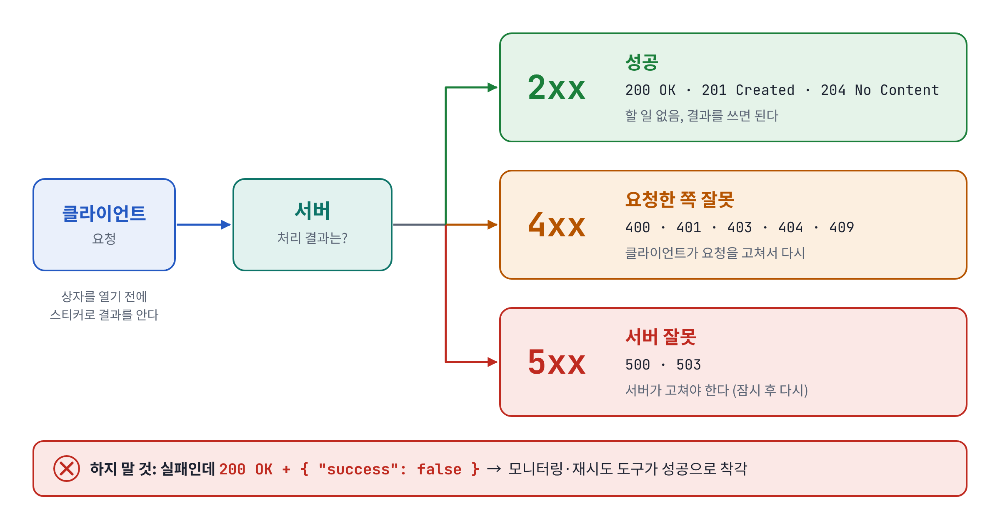

# 발표 그림

슬라이드에 넣는 그림 14장입니다. 모든 예시는 자료 전체와 같은 **블로그 API(42번 글)** 를 씁니다.

- **PNG**: PPT·키노트에 바로 붙여 넣기 (2배 해상도)
- **SVG**: 크기를 키워도 깨지지 않음. 글꼴은 Noto Sans KR · JetBrains Mono 기준이고, 없으면 맑은 고딕 · Consolas 로 대신 보입니다.

슬라이드 번호는 [발표 흐름 (15분)](발표-흐름-15분.md) 의 번호입니다.

## 클라이언트와 서버 (슬라이드 3)


> API는 프로그램끼리 주고받는 창구예요. 손님(클라이언트)은 주방(서버)에 주문서(요청)를 내고, 주방은 창고(DB)에서 재료를 꺼내 음식(응답)을 내줍니다. 손님이 창고에 직접 들어가지 않듯이, 앱도 DB를 직접 열지 않고 항상 API를 거칩니다.

파일: [`01-클라이언트와-서버.png`](01-클라이언트와-서버.png) · [`01-클라이언트와-서버.svg`](01-클라이언트와-서버.svg)

## 요청과 응답의 구조 (슬라이드 3)


> 요청은 세 부분이에요. 무엇을 어디에 할지(메서드와 주소), 부가 정보(헤더), 내용물(바디). 응답에는 결과 번호(상태 코드)와 부가 정보, 내용물이 돌아옵니다. 글을 새로 만들면 201과 함께 새 글의 주소(Location)를 알려 줘요.

파일: [`02-요청과-응답의-구조.png`](02-요청과-응답의-구조.png) · [`02-요청과-응답의-구조.svg`](02-요청과-응답의-구조.svg)

## REST 세 줄 약속 (슬라이드 4)


> REST는 이 세 칸을 채우는 약속이에요. 무엇은 URL로, 어떻게는 메서드로, 결과는 상태 코드로. 그래서 이 한 줄은 설명 없이도 '42번 글을 지웠고, 잘 끝났다'로 읽힙니다.

파일: [`03-REST-세-줄-약속.png`](03-REST-세-줄-약속.png) · [`03-REST-세-줄-약속.svg`](03-REST-세-줄-약속.svg)

## 자원 중심 URL (슬라이드 5)


> URL은 폴더 경로처럼 읽혀요. /posts는 글 목록이고, 뒤에 /42를 붙이면 42번 글, /comments를 붙이면 그 글의 댓글이에요. URL에는 명사만 쓰고, 동사는 메서드가 대신 말해 줍니다. 누구인지는 경로에, 정렬이나 개수처럼 어떻게 보여 줄지는 물음표 뒤 쿼리에 붙여요.

파일: [`04-자원-중심-URL.png`](04-자원-중심-URL.png) · [`04-자원-중심-URL.svg`](04-자원-중심-URL.svg)

## 메서드별로 달라지는 결과 (슬라이드 6)


> 같은 42번 글에 메서드만 바꿔 보내면 결과가 이렇게 달라집니다. PUT과 PATCH를 보세요. 둘 다 제목만 보냈는데, PUT은 통째로 갈아 끼워서 안 보낸 본문이 사라질 수 있고, PATCH는 보낸 칸만 고쳐요. 그래서 수정 기능은 보통 PATCH를 씁니다.

파일: [`05-메서드별-결과.png`](05-메서드별-결과.png) · [`05-메서드별-결과.svg`](05-메서드별-결과.svg)

## 멱등성 (슬라이드 6)


> POST는 자판기 버튼이에요. 세 번 보내면 글이 세 개 생깁니다. DELETE는 엘리베이터 버튼이에요. 세 번 보내도 결과는 '42번 글 없음' 하나예요. 여러 번 해도 결과가 같은 성질을 멱등이라고 합니다. 그래서 글쓰기 버튼은 한 번 누르면 막아 둡니다.

파일: [`06-멱등성.png`](06-멱등성.png) · [`06-멱등성.svg`](06-멱등성.svg)

## 상태 코드 세 갈래 (슬라이드 7)



> 상태 코드는 택배 상자 겉의 스티커예요. 열어 보지 않아도 결과를 알 수 있죠. 첫 숫자만 보면 됩니다. 2는 성공, 4는 요청한 쪽이 고쳐야 하고, 5는 서버가 고쳐야 해요. 실패했는데 200을 주면 모니터링이나 재시도 도구가 전부 성공으로 착각합니다.

파일: [`07-상태-코드-세-갈래.png`](07-상태-코드-세-갈래.png) · [`07-상태-코드-세-갈래.svg`](07-상태-코드-세-갈래.svg)

## 401과 403 (슬라이드 7)


> 401과 403은 회사 출입 게이트로 보면 쉬워요. 첫 번째 게이트에서 출입증이 없으면 401, '누구세요?'입니다. 출입증은 있지만 이 글을 지울 권한이 없으면 403, '누군지는 알지만 여긴 안 돼요'입니다. 두 게이트를 다 통과해야 삭제됩니다.

파일: [`08-401과-403.png`](08-401과-403.png) · [`08-401과-403.svg`](08-401과-403.svg)

## 공통 에러 형식 (슬라이드 8)


> API마다 에러 모양이 다르면 화면 개발자는 경우마다 따로 처리해야 해요. 심지어 실패인데 200을 주는 곳도 있죠. 그래서 모든 API가 같은 모양으로 에러를 보내게 맞춥니다. 형식은 인터넷 표준(RFC 9457)을 쓰고, 우리 팀 에러 코드(code)를 하나 더 붙여요. 화면은 문장이 아니라 이 code를 보고 판단합니다.

파일: [`09-공통-에러-형식.png`](09-공통-에러-형식.png) · [`09-공통-에러-형식.svg`](09-공통-에러-형식.svg)

## 전역 예외 처리와 입력 검증 (슬라이드 9)


> 요청은 검색대(입력 검증)를 지나 컨트롤러, 서비스, DB로 갑니다. 어디서 문제가 생기든 에러는 모두 원무과 창구 한 곳(@RestControllerAdvice)으로 모이고, 여기서 같은 양식으로 답해요. 그래서 컨트롤러에는 try-catch가 필요 없습니다. 화면에서 이미 검사했어도 API는 화면 없이도 부를 수 있으니, 서버의 검색대는 절대 생략하지 않아요.

파일: [`10-전역-예외-처리와-입력-검증.png`](10-전역-예외-처리와-입력-검증.png) · [`10-전역-예외-처리와-입력-검증.svg`](10-전역-예외-처리와-입력-검증.svg)

## 검색·정렬·페이징 주소 읽기 (슬라이드 10)


> 목록 조건은 전부 물음표 뒤에 붙여요. 도서관에서 '여행 코너에서, 제주 관련, 최신순으로, 20권씩 주세요'라고 말하는 것과 같습니다. 검색, 정렬, 페이징이 각자 자리를 갖고 있고, 안 보내면 기본값을 씁니다.

파일: [`11-검색-정렬-페이징-주소.png`](11-검색-정렬-페이징-주소.png) · [`11-검색-정렬-페이징-주소.svg`](11-검색-정렬-페이징-주소.svg)

## 오프셋과 커서 (슬라이드 10)


> 글이 100만 개면 나눠서 줘야 해요. 오프셋은 쪽 번호로 찾아가서 게시판에 잘 맞지만, 앞의 글을 세면서 건너뛰기 때문에 뒤로 갈수록 느려집니다. 커서는 '마지막으로 본 글 다음부터'라서 데이터가 많아도 빠르고 무한 스크롤에 잘 맞아요. 어느 쪽이든 size 최댓값은 꼭 정해 둡니다.

파일: [`12-오프셋과-커서.png`](12-오프셋과-커서.png) · [`12-오프셋과-커서.svg`](12-오프셋과-커서.svg)

## API 문서가 만들어지는 길 (슬라이드 11)


> 메뉴판 없는 식당에선 주문을 못 하죠. API 문서가 그 메뉴판이에요. springdoc을 쓰면 코드에서 OpenAPI 명세가 자동으로 만들어지고, Swagger UI가 그걸 화면으로 보여 줍니다. 정확도가 중요하면 테스트를 통과해야 문서가 생기는 Spring REST Docs를 써요.

파일: [`13-API-문서가-만들어지는-길.png`](13-API-문서가-만들어지는-길.png) · [`13-API-문서가-만들어지는-길.svg`](13-API-문서가-만들어지는-길.svg)

## 한 장 요약: 요청 하나의 여정 (슬라이드 12)


> 오늘 내용을 요청 하나의 여정으로 정리하면 이렇습니다. 무엇은 URL로, 어떻게는 메서드로, 입력은 서버가 다시 검사하고, 문제는 한곳에서 처리하고, 결과는 상태 코드와 같은 모양의 응답으로 돌려줍니다. 이 약속을 미리 적어 둔 메뉴판이 API 문서예요.

파일: [`14-한-장-요약.png`](14-한-장-요약.png) · [`14-한-장-요약.svg`](14-한-장-요약.svg)

## 그림 고치기

그림은 `발표/그림/만들기/그림-생성.py` 로 만듭니다. 글자나 위치를 바꾼 뒤 아래처럼 다시 만들면 됩니다.

```bash
python3 발표/그림/만들기/그림-생성.py 발표/그림     # SVG 다시 만들기
node 발표/그림/만들기/png-만들기.js 발표/그림          # PNG 다시 만들기 (Playwright 필요)
```
