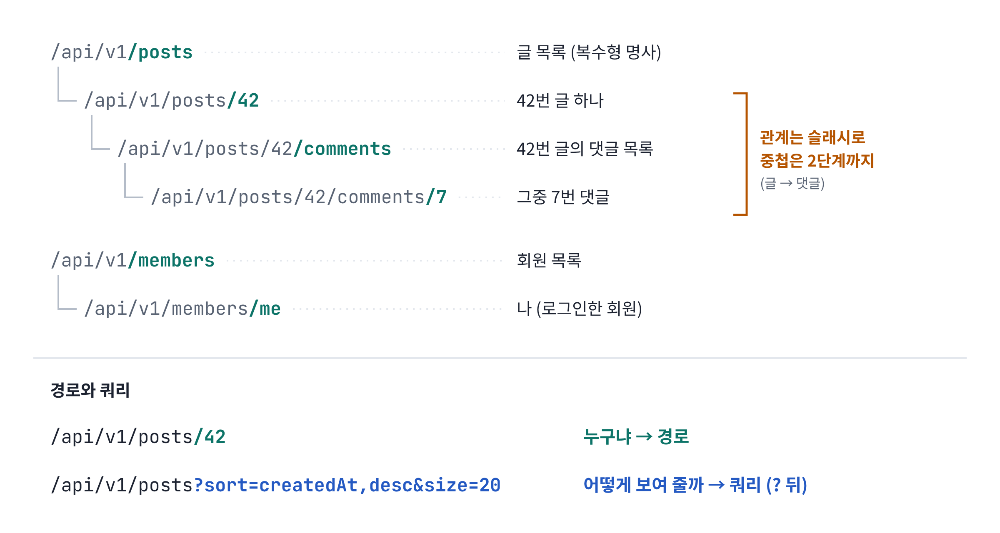

# 발표 그림

슬라이드에 넣는 그림 18장입니다. 모든 예시는 자료 전체와 같은 **블로그 API(42번 글)** 를 씁니다.

- **PNG**: PPT·키노트에 바로 붙여 넣기 (2배 해상도)
- **SVG**: 크기를 키워도 깨지지 않음. 글꼴은 Noto Sans KR · JetBrains Mono 기준이고, 없으면 맑은 고딕 · Consolas 로 대신 보입니다.

슬라이드 번호는 [발표 흐름 (15분)](발표-흐름-15분.md) 의 번호입니다.

## 클라이언트와 서버 (슬라이드 3)


> 클라이언트는 브라우저나 앱처럼 요청을 보내는 쪽이고, 서버는 그 요청을 처리하는 쪽입니다. 서버는 필요하면 DB에서 데이터를 조회하거나 저장한 뒤 결과를 응답으로 돌려줍니다. 클라이언트는 DB에 직접 접근하지 않고, 서버가 열어 둔 API를 통해서만 데이터를 주고받습니다. 이 API를 어떤 규칙으로 설계할지가 오늘 주제입니다.

파일: [`01-클라이언트와-서버.png`](01-클라이언트와-서버.png) · [`01-클라이언트와-서버.svg`](01-클라이언트와-서버.svg)

## 요청과 응답의 구조 (슬라이드 3)


> HTTP 요청은 메서드와 주소, 헤더, 바디로 구성됩니다. 메서드와 주소는 어떤 자원에 무엇을 할지, 헤더는 데이터 형식이나 인증 토큰 같은 부가 정보, 바디는 실제로 보내는 데이터입니다. 응답도 같은 구조로 상태 코드, 헤더, 바디가 돌아옵니다. 글을 생성하면 201과 함께 Location 헤더로 새 글의 주소를 알려 줍니다.

파일: [`02-요청과-응답의-구조.png`](02-요청과-응답의-구조.png) · [`02-요청과-응답의-구조.svg`](02-요청과-응답의-구조.svg)

## REST 세 줄 약속 (슬라이드 4)


> REST는 요청 한 줄을 세 부분으로 나눠 표현하는 규칙입니다. 대상 자원은 URL로, 수행할 행동은 HTTP 메서드로, 처리 결과는 상태 코드로 표현합니다. 그래서 이 한 줄은 별도 설명 없이 '42번 글을 삭제했고, 성공했다'로 읽힙니다.

파일: [`03-REST-세-줄-약속.png`](03-REST-세-줄-약속.png) · [`03-REST-세-줄-약속.svg`](03-REST-세-줄-약속.svg)

## 자원 중심 URL (슬라이드 5)



> URL은 자원의 위치를 나타내므로 명사로만 구성합니다. 컬렉션은 복수형 /posts, 그중 하나는 /posts/42, 하위 자원은 /posts/42/comments처럼 계층으로 표현합니다. 조회, 생성 같은 행동은 메서드가 표현하므로 URL에 동사를 넣지 않습니다. 특정 자원을 식별하는 값은 경로에, 정렬이나 개수처럼 표현 방식을 바꾸는 값은 쿼리 스트링에 둡니다.

파일: [`04-자원-중심-URL.png`](04-자원-중심-URL.png) · [`04-자원-중심-URL.svg`](04-자원-중심-URL.svg)

## 메서드별로 달라지는 결과 (슬라이드 6)


> 같은 42번 글에 메서드만 바꿔 보냈을 때 서버 상태가 어떻게 바뀌는지 보여 줍니다. GET은 조회만 하고, POST는 새 자원을 만들고, DELETE는 삭제합니다. PUT과 PATCH는 둘 다 수정이지만 차이가 있습니다. PUT은 자원 전체를 보낸 값으로 교체하므로 보내지 않은 본문이 비워질 수 있고, PATCH는 보낸 필드만 변경합니다. 그래서 일부 수정에는 PATCH를 씁니다.

파일: [`05-메서드별-결과.png`](05-메서드별-결과.png) · [`05-메서드별-결과.svg`](05-메서드별-결과.svg)

## 멱등성 (슬라이드 6)


> 멱등성은 같은 요청을 여러 번 보내도 서버 상태가 한 번 보낸 것과 같은 성질입니다. POST를 세 번 보내면 글이 세 개 생기므로 멱등하지 않습니다. DELETE는 두 번째부터 404가 오지만 '42번 글이 없다'는 서버 상태는 같으므로 멱등합니다. 네트워크 오류로 재시도할 때 멱등한 요청은 안전하게 다시 보낼 수 있고, POST는 중복 생성을 막는 처리가 필요합니다.

파일: [`06-멱등성.png`](06-멱등성.png) · [`06-멱등성.svg`](06-멱등성.svg)

## 상태 코드 네 갈래 (슬라이드 7)


> 상태 코드는 첫 자리로 결과의 종류를 나눕니다. 2xx는 성공, 3xx는 리다이렉트, 4xx는 클라이언트 오류, 5xx는 서버 오류입니다. 3xx는 주소가 바뀌었거나(301, 302) 캐시를 그대로 써도 될 때(304) 쓰는데, REST API에서는 드물게 씁니다. 실제로 주로 다루는 건 2xx와 4xx, 5xx입니다. 클라이언트는 바디를 파싱하기 전에 상태 코드로 결과를 판단하므로, 실패를 200과 success: false로 보내면 모니터링, 재시도, 캐시가 모두 성공으로 처리합니다.

파일: [`07-상태-코드-네-갈래.png`](07-상태-코드-네-갈래.png) · [`07-상태-코드-네-갈래.svg`](07-상태-코드-네-갈래.svg)

## 자주 만나는 에러 상태 코드 (슬라이드 7)


> 실무에서 에러가 나면 대부분 이 아홉 가지 중 하나입니다. 4xx는 요청을 고쳐야 하는 경우입니다. 400은 필수 값이 빠졌거나 형식이 틀린 경우, 401은 토큰이 없거나 만료된 경우, 403은 권한이 없는 경우, 404는 자원이 없거나 URL이 틀린 경우, 409는 중복이나 동시 수정 충돌입니다. 5xx는 서버 쪽 문제입니다. 500은 처리하지 못한 예외라 서버 로그의 스택 트레이스를 봐야 합니다. 502, 503, 504는 게이트웨이나 프록시 뒤의 서버가 잘못된 응답을 줬거나, 처리할 수 없는 상태거나, 제한 시간 안에 응답하지 않은 경우입니다. 그중 가장 자주 보는 건 400, 401, 404, 500입니다.

파일: [`07b-자주-만나는-에러-코드.png`](07b-자주-만나는-에러-코드.png) · [`07b-자주-만나는-에러-코드.svg`](07b-자주-만나는-에러-코드.svg)

## 401과 403 (슬라이드 7)


> 401과 403은 실패한 단계가 다릅니다. 401은 인증 실패로, 토큰이 없거나 만료되어 서버가 요청한 사람이 누구인지 확인하지 못한 경우입니다. 403은 인가 실패로, 누구인지는 확인했지만 이 작업을 할 권한이 없는 경우입니다. 예를 들어 다른 사람의 글을 삭제하려 하면 403입니다.

파일: [`08-401과-403.png`](08-401과-403.png) · [`08-401과-403.svg`](08-401과-403.svg)

## 공통 에러 형식 (슬라이드 8)


> API마다 에러 응답 구조가 다르면 클라이언트는 API별로 에러 처리 코드를 따로 작성해야 합니다. 그래서 모든 API의 에러 응답을 하나의 형식으로 통일합니다. 형식은 RFC 9457 Problem Details 표준의 type, title, status, detail을 쓰고, 팀에서 정의한 에러 코드 code를 추가합니다. 메시지 문장은 바뀔 수 있으므로 클라이언트는 code 값으로 분기합니다. 스택 트레이스나 SQL 같은 내부 정보는 응답에 넣지 않습니다.

파일: [`09-공통-에러-형식.png`](09-공통-에러-형식.png) · [`09-공통-에러-형식.svg`](09-공통-에러-형식.svg)

## 전역 예외 처리와 입력 검증 (슬라이드 9)


> 요청은 입력 검증, 컨트롤러, 서비스, DB 순서로 처리됩니다. 요청 DTO의 형식 오류는 @Valid에서 걸러 400을 주고, 글이 없거나 제목이 중복되는 업무 규칙 위반은 서비스에서 예외를 던집니다. 이 예외들은 모두 @RestControllerAdvice 한 곳에서 받아 상태 코드와 공통 에러 형식으로 변환합니다. 그래서 컨트롤러마다 try-catch를 쓸 필요가 없습니다. 클라이언트에서 검증했더라도 API는 직접 호출될 수 있으므로 서버 검증은 생략하지 않습니다.

파일: [`10-전역-예외-처리와-입력-검증.png`](10-전역-예외-처리와-입력-검증.png) · [`10-전역-예외-처리와-입력-검증.svg`](10-전역-예외-처리와-입력-검증.svg)

## 검색·정렬·페이징 주소 읽기 (슬라이드 10)


> 목록 조회의 조건은 모두 쿼리 스트링으로 전달합니다. 검색 조건은 topic, keyword, 정렬은 sort=필드,방향, 페이징은 page와 size로 표현합니다. 값을 보내지 않으면 서버가 정한 기본값, 예를 들어 최신순 20개를 적용합니다.

파일: [`11-검색-정렬-페이징-주소.png`](11-검색-정렬-페이징-주소.png) · [`11-검색-정렬-페이징-주소.svg`](11-검색-정렬-페이징-주소.svg)

## 오프셋과 커서 (슬라이드 10)


> 페이징 방식은 두 가지입니다. 오프셋은 page와 size로 앞의 데이터를 건너뛰고 가져오는 방식으로, 페이지 번호로 바로 이동할 수 있어 게시판에 맞습니다. 대신 뒤 페이지일수록 건너뛸 행이 많아져 느려지고, 그사이 새 글이 추가되면 결과가 겹치거나 빠질 수 있습니다. 커서는 마지막으로 받은 항목의 기준값 다음부터 가져오는 방식이라 데이터가 많아도 성능이 일정하고 무한 스크롤에 맞습니다. 어느 방식이든 size 최댓값, 기본 정렬, 정렬 가능한 필드는 서버에서 제한합니다.

파일: [`12-오프셋과-커서.png`](12-오프셋과-커서.png) · [`12-오프셋과-커서.svg`](12-오프셋과-커서.svg)

## API 문서가 만들어지는 길 (슬라이드 11)


> API 문서는 OpenAPI 명세로 작성합니다. springdoc을 쓰면 컨트롤러와 DTO의 어노테이션을 읽어 명세가 자동으로 만들어지고, Swagger UI가 그 명세를 화면으로 보여 주며 직접 호출도 할 수 있습니다. 문서와 실제 동작이 어긋나지 않는 게 중요하다면, 테스트가 통과해야 문서가 생성되는 Spring REST Docs를 씁니다. 문서에는 메서드와 URL, 인증 방식, 요청·응답 예시, 에러 코드 표가 들어가야 합니다.

파일: [`13-API-문서가-만들어지는-길.png`](13-API-문서가-만들어지는-길.png) · [`13-API-문서가-만들어지는-길.svg`](13-API-문서가-만들어지는-길.svg)

## 단일 서버의 요청 흐름 (슬라이드 12 앞 (추가))


> 단일 서버에서는 애플리케이션 하나가 요청을 모두 처리합니다. 인증 필터가 토큰을 확인하고, URL 매핑이 경로와 메서드를 보고 CommentController를 고릅니다. CommentService는 42번 글이 있는지 PostService에 메서드 호출로 확인합니다. 같은 프로세스 안이라 네트워크를 타지 않습니다. 데이터는 DB 하나에 저장합니다. 구조가 단순하고 빠르지만, 댓글 기능만 따로 배포하거나 확장하기는 어렵습니다.

파일: [`15-단일-서버의-요청-흐름.png`](15-단일-서버의-요청-흐름.png) · [`15-단일-서버의-요청-흐름.svg`](15-단일-서버의-요청-흐름.svg)

## MSA의 요청 흐름 (슬라이드 12 앞 (추가))


> MSA에서는 기능별로 서비스를 나눠 따로 배포하고, 서비스마다 자기 DB를 가집니다. 외부 요청은 API Gateway 하나로 들어오고, 게이트웨이가 인증을 처리한 뒤 경로를 보고 comment-service로 전달합니다. comment-service는 42번 글이 있는지 post-service에 HTTP로 GET 요청을 보냅니다. 단일 서버에서 메서드 호출이던 부분이 REST API 호출로 바뀌는 겁니다. 그래서 서비스끼리 통신할 때도 오늘 다룬 URL, 메서드, 상태 코드 규칙이 그대로 적용됩니다. 클라이언트가 보내는 요청은 단일 서버와 똑같습니다.

파일: [`16-MSA의-요청-흐름.png`](16-MSA의-요청-흐름.png) · [`16-MSA의-요청-흐름.svg`](16-MSA의-요청-흐름.svg)

## MSA에서 에러가 전달되는 흐름 (슬라이드 12 앞 (추가))


> 42번 글이 없으면 post-service가 404와 POST_NOT_FOUND를 돌려줍니다. comment-service와 게이트웨이가 같은 상태 코드와 에러 형식을 쓰면, 이 에러는 그대로 클라이언트까지 전달됩니다. 클라이언트는 어느 서비스에서 에러가 났는지 몰라도 code만 보고 처리할 수 있습니다. post-service가 꺼져 있으면 503, 제한 시간 안에 응답이 없으면 504를 줍니다. 모든 에러를 500으로 뭉뚱그리지 않고 원인에 맞는 코드를 주는 이유가 여기 있습니다.

파일: [`17-MSA에서-에러가-전달되는-흐름.png`](17-MSA에서-에러가-전달되는-흐름.png) · [`17-MSA에서-에러가-전달되는-흐름.svg`](17-MSA에서-에러가-전달되는-흐름.svg)

## 한 장 요약: 요청 하나의 여정 (슬라이드 12)


> 오늘 내용을 요청 하나의 처리 순서로 정리하면 이렇습니다. 자원은 URL로, 행동은 메서드로 표현하고, 입력은 서버에서 검증하고, 예외는 한곳에서 처리하고, 결과는 상태 코드와 공통 응답 형식으로 돌려줍니다. 목록은 쿼리로 나눠서 주고, 이 모든 규칙은 API 문서로 공개합니다.

파일: [`14-한-장-요약.png`](14-한-장-요약.png) · [`14-한-장-요약.svg`](14-한-장-요약.svg)

## 그림 고치기

그림은 `발표/그림/만들기/그림-생성.py` 로 만듭니다. 글자나 위치를 바꾼 뒤 아래처럼 다시 만들면 됩니다.

```bash
python3 발표/그림/만들기/그림-생성.py 발표/그림     # SVG 다시 만들기
node 발표/그림/만들기/png-만들기.js 발표/그림          # PNG 다시 만들기 (Playwright 필요)
```
