# 발표 그림

슬라이드에 넣는 그림 24장과 실제 화면 5장입니다. 모든 예시는 자료 전체와 같은 **블로그 API(42번 글)** 를 씁니다.

- **PNG**: PPT·키노트에 바로 붙여 넣기 (2배 해상도)
- **SVG**: 크기를 키워도 깨지지 않음. 글꼴은 Noto Sans KR · JetBrains Mono 기준이고, 없으면 맑은 고딕 · Consolas 로 대신 보입니다.

슬라이드 번호는 [발표 흐름 (15분)](발표-흐름-15분.md) 의 번호입니다.

## API와 RESTful API (슬라이드 2)

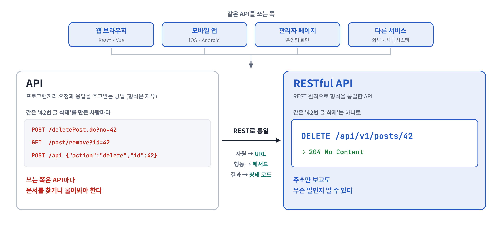

> API는 프로그램끼리 요청과 응답을 주고받는 방법입니다. 우리가 만드는 API는 웹, 모바일 앱, 관리자 페이지, 다른 서비스가 모두 같이 씁니다. 그런데 API는 형식이 정해져 있지 않아서, 같은 "42번 글 삭제"도 만든 사람마다 왼쪽처럼 제각각일 수 있습니다. 그러면 쓰는 쪽은 API마다 문서를 찾거나 물어봐야 합니다. 그래서 REST라는 원칙으로 형식을 통일합니다. 자원은 URL로, 행동은 HTTP 메서드로, 결과는 상태 코드로 표현합니다. 이렇게 만든 API가 RESTful API입니다. DELETE /api/v1/posts/42 한 줄만 봐도 42번 글을 삭제한다는 걸 알 수 있습니다. 그럼 먼저, 이런 요청을 왜 보내는지부터 보겠습니다.

파일: [`00-0-API와-RESTful-API.png`](00-0-API와-RESTful-API.png) · [`00-0-API와-RESTful-API.svg`](00-0-API와-RESTful-API.svg)

## 왜 요청을 보내나 (슬라이드 3)

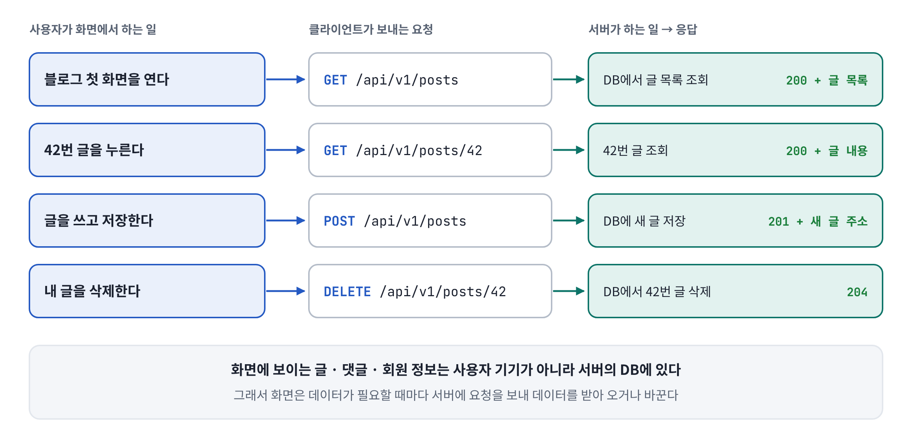

> 웹이나 앱 화면에 보이는 글, 댓글, 회원 정보는 사용자 기기가 아니라 서버의 DB에 있습니다. 그래서 화면은 데이터가 필요할 때마다 서버에 요청을 보냅니다. 첫 화면을 열면 글 목록을 조회하는 GET이, 저장 버튼을 누르면 글을 만드는 POST가 나갑니다. 사용자의 동작 하나가 HTTP 요청 하나입니다.

파일: [`00-왜-요청을-보내나.png`](00-왜-요청을-보내나.png) · [`00-왜-요청을-보내나.svg`](00-왜-요청을-보내나.svg)

## 클라이언트와 서버 (슬라이드 3)

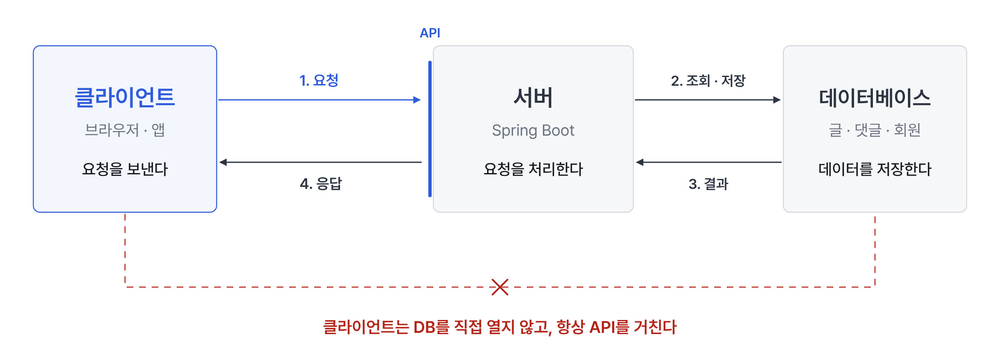

> 구조로 보면 클라이언트가 요청을 보내고, 서버가 DB를 조회하거나 저장한 뒤 응답합니다. 클라이언트는 DB에 직접 접근하지 않고 항상 API를 거칩니다. 요청에는 메서드, 주소, 헤더, 바디가 들어 있고, 응답으로는 상태 코드, 헤더, 바디가 돌아옵니다.

파일: [`01-클라이언트와-서버.png`](01-클라이언트와-서버.png) · [`01-클라이언트와-서버.svg`](01-클라이언트와-서버.svg)

## REST 세 줄 약속 (슬라이드 4)

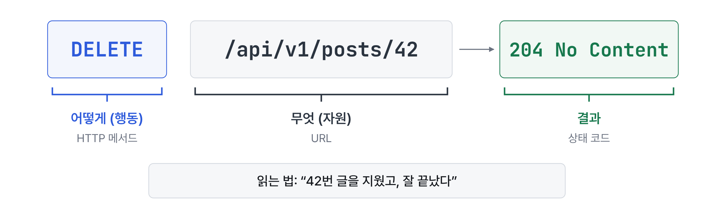

> 요청 한 줄을 REST로 읽으면 이렇습니다. DELETE는 행동, /api/v1/posts/42는 자원, 204는 결과입니다. 이제 이 세 부분을 URL, 메서드, 상태 코드 순서로 보겠습니다.

파일: [`03-REST-세-줄-약속.png`](03-REST-세-줄-약속.png) · [`03-REST-세-줄-약속.svg`](03-REST-세-줄-약속.svg)

## 동사 URL의 문제 (슬라이드 5)

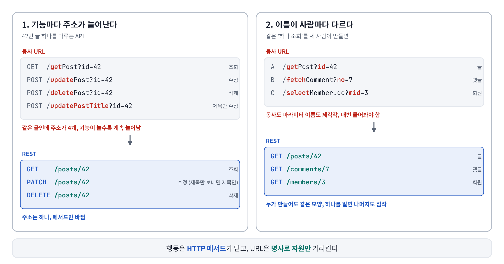

> 먼저 URL입니다. URL에 동사를 넣으면 두 가지 문제가 생깁니다. 첫째, 같은 42번 글인데도 getPost, updatePost, deletePost처럼 기능마다 주소가 하나씩 늘어납니다. 둘째, 이름이 사람마다 다릅니다. 같은 조회를 누구는 getPost, 누구는 fetchComment, 누구는 selectMember.do라고 짓고, 파라미터 이름도 id, no, mid로 제각각입니다. 그래서 행동은 메서드에 맡기고 URL은 명사로 자원만 가리킵니다. 그러면 /posts/42 하나에 메서드만 바꿔 조회, 수정, 삭제를 하고, 댓글은 /comments/7, 회원은 /members/3처럼 누가 만들어도 같은 모양이 됩니다.

파일: [`04-0-동사-URL의-문제.png`](04-0-동사-URL의-문제.png) · [`04-0-동사-URL의-문제.svg`](04-0-동사-URL의-문제.svg)

## 동사 URL과 자원 URL (슬라이드 5)

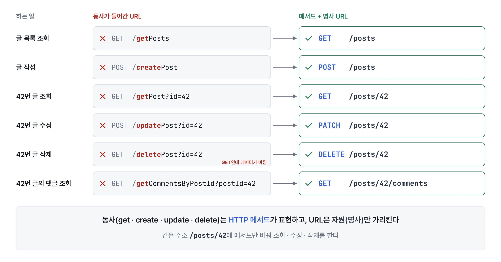

> 자주 쓰는 기능을 바꿔 보면 이렇습니다. 동사는 빠지고, 같은 주소에 메서드만 달라집니다. 특히 삭제를 GET으로 만들면 안 됩니다. GET은 데이터를 바꾸지 않는 요청으로 정의되어 있어서, 검색 엔진 크롤러나 메신저의 링크 미리보기는 사용자가 누르지 않아도 GET을 보냅니다. 삭제 URL을 메신저로 보내기만 해도 글이 지워질 수 있습니다.

파일: [`04a-동사-URL과-자원-URL.png`](04a-동사-URL과-자원-URL.png) · [`04a-동사-URL과-자원-URL.svg`](04a-동사-URL과-자원-URL.svg)

## 자원 중심 URL (슬라이드 5)

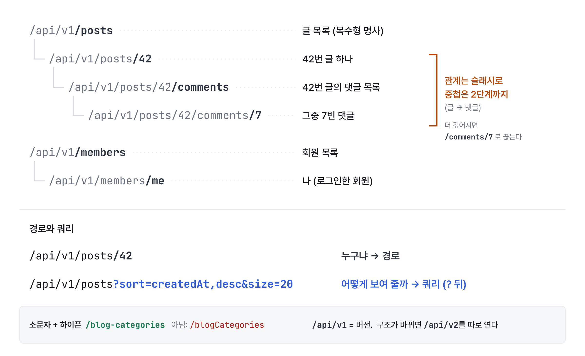

> 명사 URL은 계층으로 짭니다. 글 목록은 /posts, 42번 글은 /posts/42, 그 글의 댓글은 /posts/42/comments입니다. 중첩은 2단계까지만 둡니다. 더 깊어지면 상위 id를 모두 알아야 하니, 댓글 하나는 /comments/7처럼 끊습니다. 어떤 자원인지는 경로에, 정렬이나 개수처럼 보여 주는 방식은 물음표 뒤 쿼리에 둡니다. URL은 소문자와 하이픈으로 쓰고, 앞의 /api/v1은 버전입니다. 응답 구조를 크게 바꿔야 할 때 예전 앱이 깨지지 않도록 /api/v2를 따로 열기 위해 붙여 둡니다.

파일: [`04b-자원-중심-URL.png`](04b-자원-중심-URL.png) · [`04b-자원-중심-URL.svg`](04b-자원-중심-URL.svg)

## 메서드별로 달라지는 결과 (슬라이드 6)

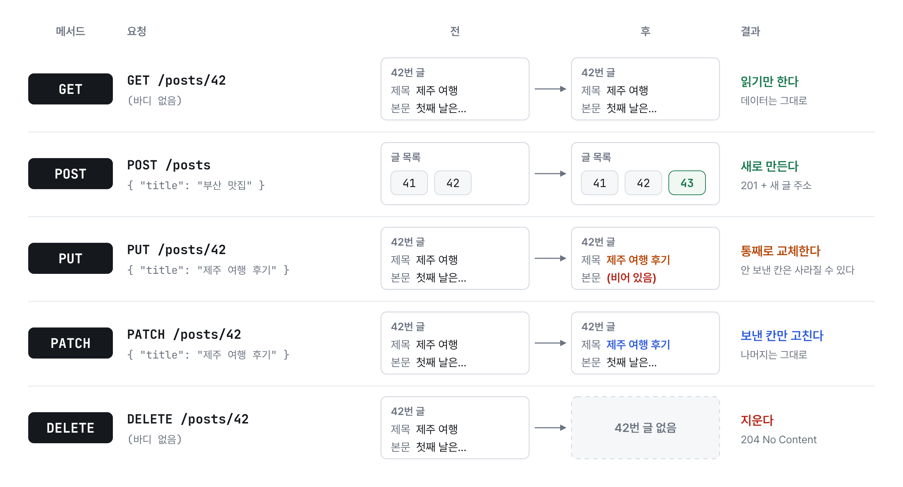

> 다음은 메서드입니다. 같은 42번 글에 메서드만 바꿔 보내면 결과가 이렇게 달라집니다. GET은 조회, POST는 생성, DELETE는 삭제입니다. 헷갈리는 건 PUT과 PATCH입니다. 둘 다 제목만 보냈는데, PUT은 자원 전체를 교체해서 안 보낸 본문이 비워질 수 있고, PATCH는 보낸 필드만 바꿉니다. 그래서 일부 수정에는 PATCH를 씁니다. 하나 더, PUT과 DELETE는 여러 번 보내도 결과가 같지만, POST는 보낼 때마다 글이 하나씩 생깁니다. 그래서 글쓰기 버튼은 한 번 누르면 막아 두고, 결제처럼 중요한 POST는 중복 요청을 막는 처리를 합니다.

파일: [`05-메서드별-결과.png`](05-메서드별-결과.png) · [`05-메서드별-결과.svg`](05-메서드별-결과.svg)

## 상태 코드 네 갈래 (슬라이드 7)

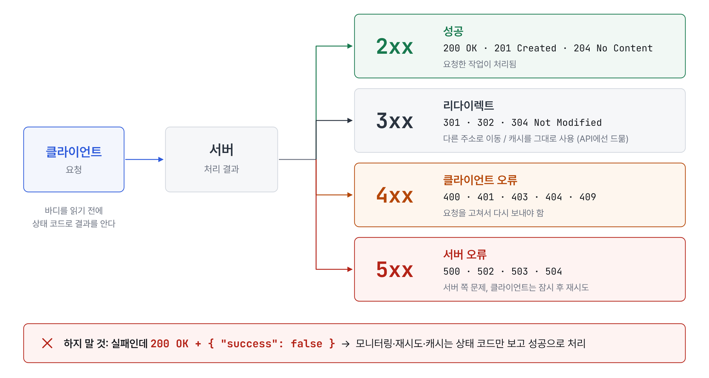

> 결과는 상태 코드로 알립니다. 첫 자리로 종류가 나뉩니다. 2xx는 성공, 3xx는 리다이렉트, 4xx는 요청한 쪽 문제, 5xx는 서버 문제입니다. API에서는 주로 2xx, 4xx, 5xx를 씁니다. 하지 말아야 할 게 하나 있습니다. 실패했는데 200 OK에 success: false를 담아 보내는 방식입니다. 모니터링, 프론트엔드의 에러 처리, 자동 재시도, 캐시는 바디를 읽지 않고 상태 코드만 봅니다. 그래서 실패를 200으로 주면 장애가 나도 알림이 오지 않고, 화면에는 저장 완료가 뜹니다. 세밀한 구분이 필요하면 상태 코드는 그대로 두고, 바디에 에러 코드를 따로 담습니다. 이건 바로 다음에 보겠습니다.

파일: [`07-상태-코드-네-갈래.png`](07-상태-코드-네-갈래.png) · [`07-상태-코드-네-갈래.svg`](07-상태-코드-네-갈래.svg)

## 자주 만나는 에러 상태 코드 (슬라이드 7)

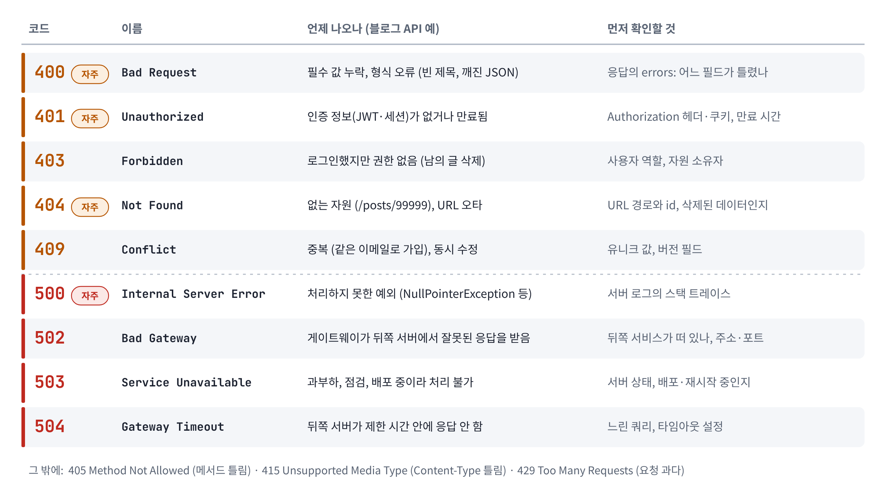

> 실무에서 에러가 나면 대부분 이 아홉 개 중 하나입니다. 가장 자주 보는 건 400, 401, 404, 500입니다. 400은 값이 빠졌거나 형식이 틀린 경우, 404는 자원이 없거나 URL이 틀린 경우, 500은 서버가 처리하지 못한 예외라 서버 로그를 봐야 합니다. 헷갈리는 401과 403은 실패한 단계가 다릅니다. 401은 JWT나 세션이 없거나 만료되어 누구인지 모르는 경우, 403은 누구인지는 알지만 권한이 없는 경우입니다. 502, 503, 504는 게이트웨이 뒤의 서버에 문제가 있을 때 나옵니다.

파일: [`07b-자주-만나는-에러-코드.png`](07b-자주-만나는-에러-코드.png) · [`07b-자주-만나는-에러-코드.svg`](07b-자주-만나는-에러-코드.svg)

## 공통 에러 형식 (슬라이드 8)

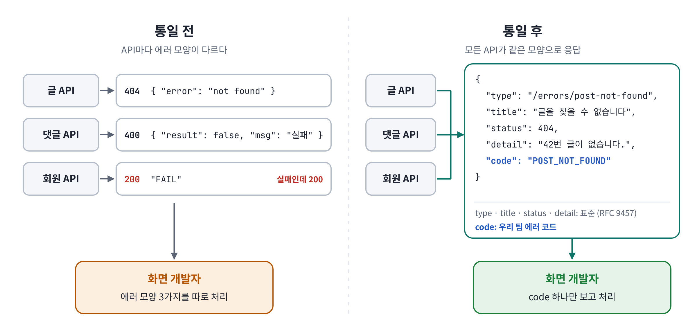

> 응답도 형식을 하나로 맞춥니다. 성공 응답은 단건이면 자원을 그대로, 목록이면 content와 page로 감싸서 주고, 필드 이름은 camelCase, 날짜는 ISO-8601로 통일합니다. 그럼 에러는 어떻게 보낼까요. 왼쪽처럼 API마다 에러 모양이 다르면, 프론트엔드는 API마다 에러를 꺼내는 코드를 따로 짜야 하고, 문장으로 분기했다가 백엔드가 문구를 고치면 깨집니다. 회원 API는 앞에서 말한 200 문제까지 있습니다. 그래서 오른쪽처럼 모든 API가 같은 형식으로 보냅니다. RFC 9457 표준의 type, title, status, detail에 우리 팀 에러 코드 code를 붙입니다. 프론트엔드는 에러 처리를 한 곳에만 쓰고, code로 분기하고, detail 문장은 화면에 보여 주기만 합니다. 스택 트레이스나 SQL 같은 내부 정보는 응답에 넣지 않고 서버 로그에만 남깁니다.

파일: [`09-공통-에러-형식.png`](09-공통-에러-형식.png) · [`09-공통-에러-형식.svg`](09-공통-에러-형식.svg)

## 전역 예외 처리와 입력 검증 (슬라이드 9)

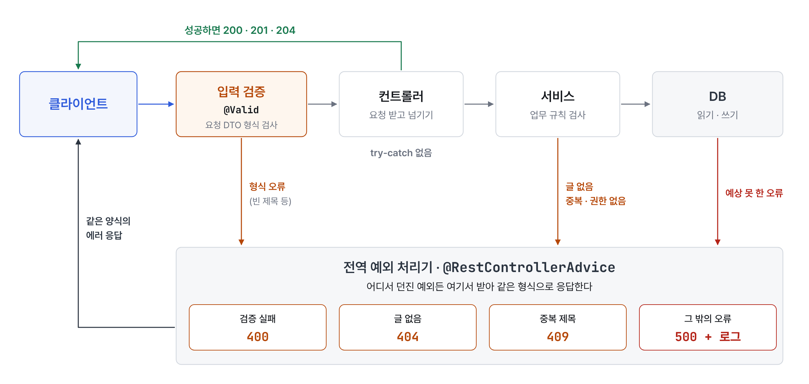

> 이 형식을 모든 API가 지키게 하는 방법이 전역 예외 처리입니다. 요청은 입력 검증, 컨트롤러, 서비스, DB 순서로 처리되고, 성공하면 초록 화살표처럼 응답이 나갑니다. 실패는 두 종류입니다. 제목이 비었다처럼 값만 보면 아는 건 맨 앞의 입력 검증에서 400으로 돌려보냅니다. 글이 없다, 제목이 중복이다처럼 DB를 봐야 아는 건 서비스에서 예외를 던집니다. 던진 예외는 호출한 쪽으로 거꾸로 올라가서, 결국 아래의 전역 예외 처리기 한 곳에 모입니다. 여기서 상태 코드와 앞에서 본 공통 에러 형식으로 바꿔 응답합니다. 예상 못 한 예외는 로그를 남기고 500으로 답합니다.

파일: [`10-전역-예외-처리와-입력-검증.png`](10-전역-예외-처리와-입력-검증.png) · [`10-전역-예외-처리와-입력-검증.svg`](10-전역-예외-처리와-입력-검증.svg)

## 검색·정렬·페이징 주소 읽기 (슬라이드 10)

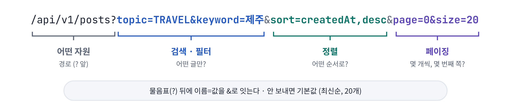

> (1단계) 글 목록 API는 어떤 글을, 어떤 순서로, 몇 개씩 줄지를 정해야 합니다. (2단계) 검색 조건은 topic, keyword로, (3단계) 정렬은 sort=필드,방향으로, (4단계) 페이징은 page와 size로 받습니다. 앞에서 말했듯 보여 주는 방식이니 모두 쿼리에 붙이고, 안 보내면 최신순 20개가 기본입니다.

파일: [`11-검색-정렬-페이징-주소.png`](11-검색-정렬-페이징-주소.png) · [`11-검색-정렬-페이징-주소.svg`](11-검색-정렬-페이징-주소.svg)

## 목록 응답 형식 (슬라이드 10)

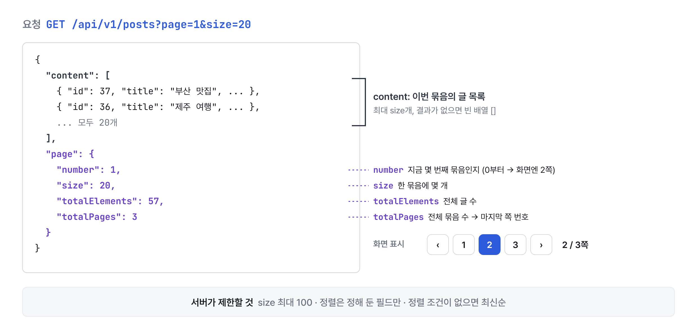

> 응답에는 글 목록과 함께 전체 개수, 전체 페이지 수 같은 페이지 정보를 줘야 화면이 페이지 번호를 그릴 수 있습니다. 결과가 없으면 404가 아니라 200과 빈 배열입니다. 대신 서버는 size 최댓값, 정렬 가능한 필드, 기본 정렬을 정해 둡니다. size=1000000 요청 하나로 서버가 멈추면 안 되니까요.

파일: [`11b-목록-응답-형식.png`](11b-목록-응답-형식.png) · [`11b-목록-응답-형식.svg`](11b-목록-응답-형식.svg)

## API 문서가 만들어지는 길 (슬라이드 11)

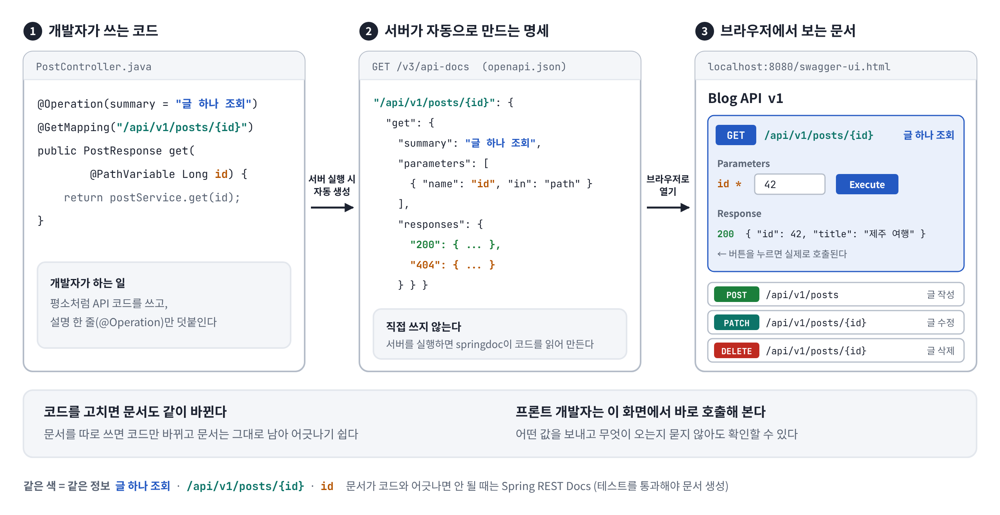

> 마지막은 문서입니다. 문서를 따로 쓰면 코드만 바뀌고 문서는 그대로 남기 쉽습니다. 그래서 코드에서 자동으로 만듭니다. 개발자가 컨트롤러에 설명 한 줄을 달면, 서버가 실행될 때 springdoc이 OpenAPI라는 표준 형식의 명세를 만들고, Swagger UI가 그걸 화면으로 보여 줍니다. 같은 색 글자가 코드에서 그대로 넘어온 정보입니다.

파일: [`13-API-문서가-만들어지는-길.png`](13-API-문서가-만들어지는-길.png) · [`13-API-문서가-만들어지는-길.svg`](13-API-문서가-만들어지는-길.svg)

## 실제 화면: Swagger에서 실행 (200) (슬라이드 11)

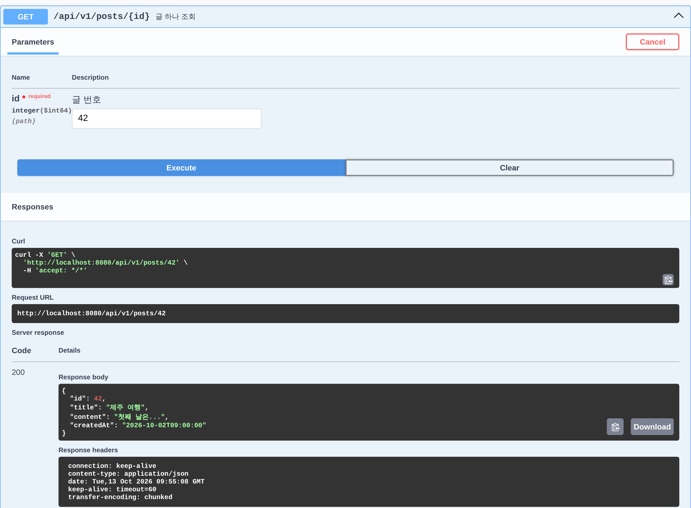

> 실제 화면입니다. id에 42를 넣고 Execute를 누르면 실제로 요청이 나가고 200과 글 내용이 옵니다. 프론트 개발자는 묻지 않고 여기서 바로 호출해 볼 수 있습니다.

파일: [`실제-화면/swagger-2-실행-200.png`](실제-화면/swagger-2-실행-200.png) (예제 프로젝트를 실행해 찍은 실제 화면)

## 실제 화면: REST Docs 응답 필드 (슬라이드 11)

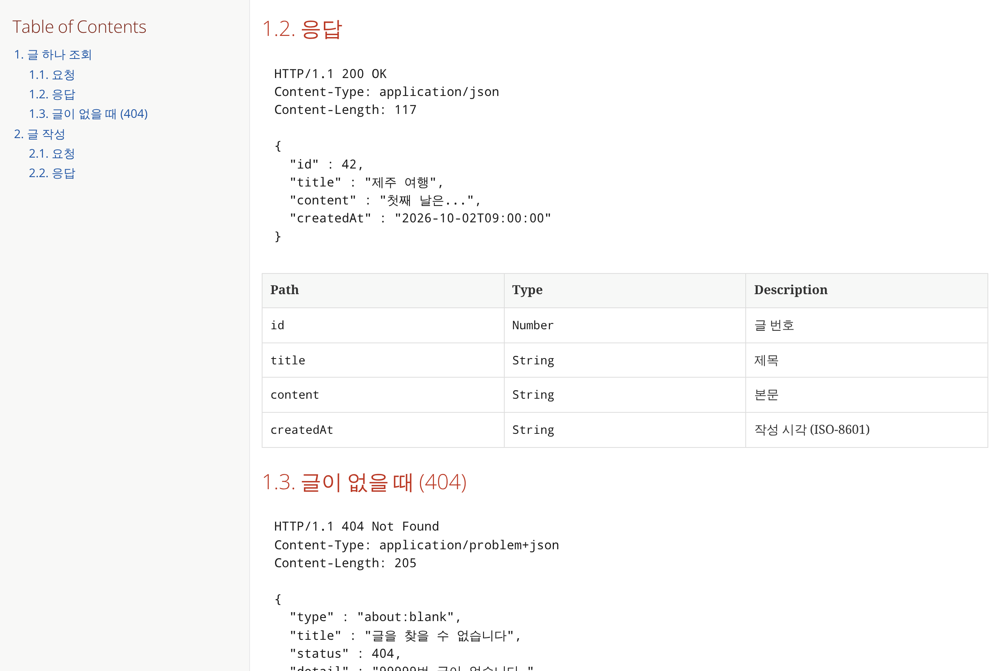

> Spring REST Docs로 만든 문서도 있습니다. 테스트가 실제로 주고받은 요청과 응답으로 만들어져서, 코드와 문서가 어긋나면 테스트가 실패합니다.

파일: [`실제-화면/restdocs-2-응답.png`](실제-화면/restdocs-2-응답.png) (예제 프로젝트를 실행해 찍은 실제 화면)

## API 문서 만드는 방법 (슬라이드 11)

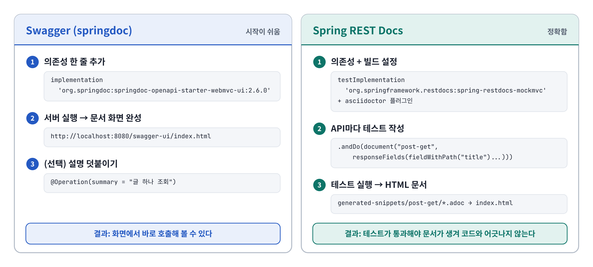

> 만드는 방법은 간단합니다. Swagger는 의존성 한 줄을 추가하고 서버를 켜면 끝이고, REST Docs는 API마다 테스트를 쓰면 문서가 만들어집니다. 시작은 Swagger, 정확도가 중요하면 REST Docs를 씁니다.

파일: [`13b-문서-만드는-방법.png`](13b-문서-만드는-방법.png) · [`13b-문서-만드는-방법.svg`](13b-문서-만드는-방법.svg)

## 한 장 요약: 요청 하나의 여정 (슬라이드 12)

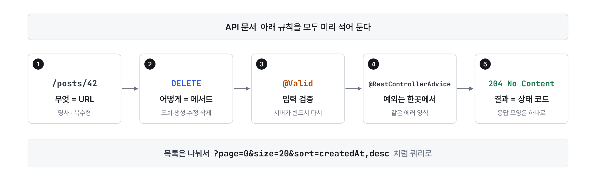

> 오늘 내용을 요청 하나의 순서로 정리하면 이렇습니다. 자원은 URL로, 행동은 메서드로 표현하고, 입력은 서버에서 검증하고, 예외는 한곳에서 처리하고, 결과는 상태 코드와 같은 형식의 응답으로 돌려줍니다. 목록은 쿼리로 나눠서 주고, 이 모든 규칙은 문서로 공개합니다. 이 규칙을 지키면 처음 보는 사람도 주소만 보고 API를 읽을 수 있습니다. 감사합니다.

파일: [`14-한-장-요약.png`](14-한-장-요약.png) · [`14-한-장-요약.svg`](14-한-장-요약.svg)

## 요청과 응답의 구조 (예비 슬라이드)

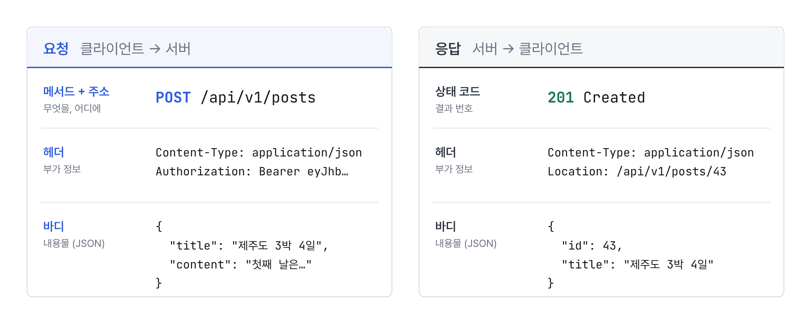

> 질문이 나오면 꺼내는 예비 슬라이드입니다 (요청·응답에 무엇이 들어 있는지 물으면). HTTP 요청은 메서드와 주소, 헤더, 바디로 구성됩니다. 메서드와 주소는 어떤 자원에 무엇을 할지, 헤더는 데이터 형식이나 인증 토큰 같은 부가 정보, 바디는 실제로 보내는 데이터입니다. 응답도 같은 구조로 상태 코드, 헤더, 바디가 돌아옵니다. 글을 생성하면 201과 함께 Location 헤더로 새 글의 주소를 알려 줍니다.

파일: [`02-요청과-응답의-구조.png`](02-요청과-응답의-구조.png) · [`02-요청과-응답의-구조.svg`](02-요청과-응답의-구조.svg)

## 멱등성 (예비 슬라이드)

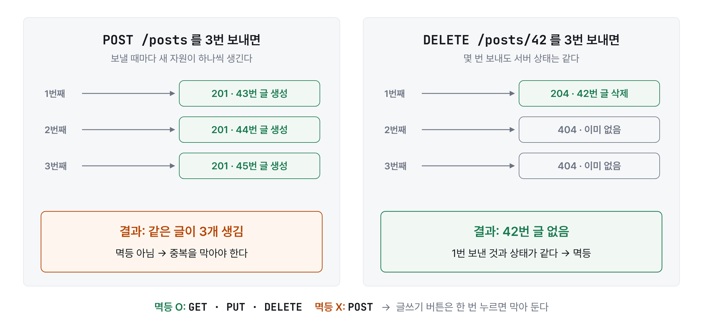

> 질문이 나오면 꺼내는 예비 슬라이드입니다 (멱등성이 뭔지, 재시도는 왜 안전한지 물으면). 멱등성은 같은 요청을 여러 번 보내도 서버 상태가 한 번 보낸 것과 같은 성질입니다. POST를 세 번 보내면 글이 세 개 생기므로 멱등하지 않습니다. DELETE는 두 번째부터 404가 오지만 '42번 글이 없다'는 서버 상태는 같으므로 멱등합니다. 네트워크 오류로 재시도할 때 멱등한 요청은 안전하게 다시 보낼 수 있고, POST는 중복 생성을 막는 처리가 필요합니다.

파일: [`06-멱등성.png`](06-멱등성.png) · [`06-멱등성.svg`](06-멱등성.svg)

## 401과 403 (예비 슬라이드)

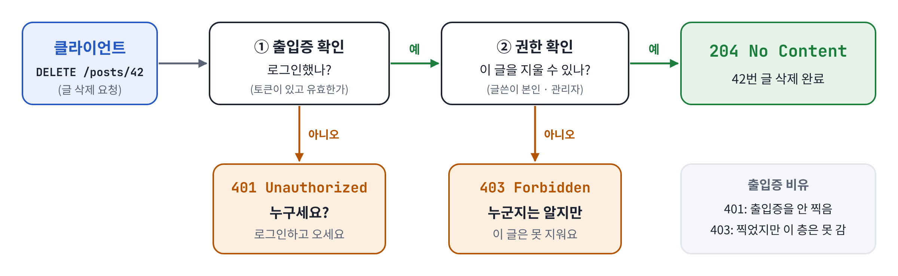

> 질문이 나오면 꺼내는 예비 슬라이드입니다 (401과 403 차이를 더 자세히 물으면). 401과 403은 실패한 단계가 다릅니다. 401은 인증 실패로, JWT나 세션 같은 인증 정보가 없거나 만료되어 서버가 요청한 사람이 누구인지 확인하지 못한 경우입니다. 403은 인가 실패로, 누구인지는 확인했지만 이 작업을 할 권한이 없는 경우입니다. 예를 들어 다른 사람의 글을 삭제하려 하면 403입니다.

파일: [`08-401과-403.png`](08-401과-403.png) · [`08-401과-403.svg`](08-401과-403.svg)

## 오프셋과 커서 (예비 슬라이드)

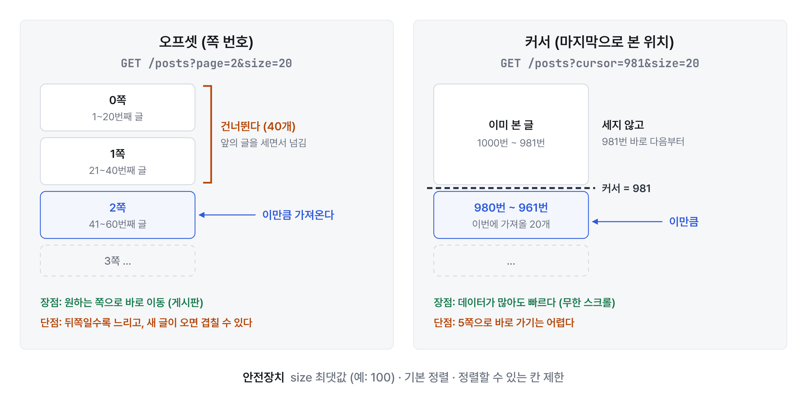

> 질문이 나오면 꺼내는 예비 슬라이드입니다 (오프셋과 커서 페이징 차이를 물으면). 예비 슬라이드입니다. 발표에서는 '페이지 번호가 있는 게시판은 page 방식(오프셋), 무한 스크롤은 마지막으로 본 글 다음부터 가져오는 커서 방식' 한 문장만 말하고, 질문이 나오면 이 그림을 보여 줍니다. 오프셋은 쪽 번호로 바로 이동할 수 있지만 앞의 글을 세며 건너뛰기 때문에 뒤로 갈수록 느려지고, 그사이 새 글이 들어오면 결과가 겹칠 수 있습니다. 커서는 마지막으로 받은 항목 다음부터 가져와서 데이터가 많아도 성능이 일정합니다.

파일: [`12-오프셋과-커서.png`](12-오프셋과-커서.png) · [`12-오프셋과-커서.svg`](12-오프셋과-커서.svg)

## 실제 화면: Swagger UI 목록 (예비 슬라이드)

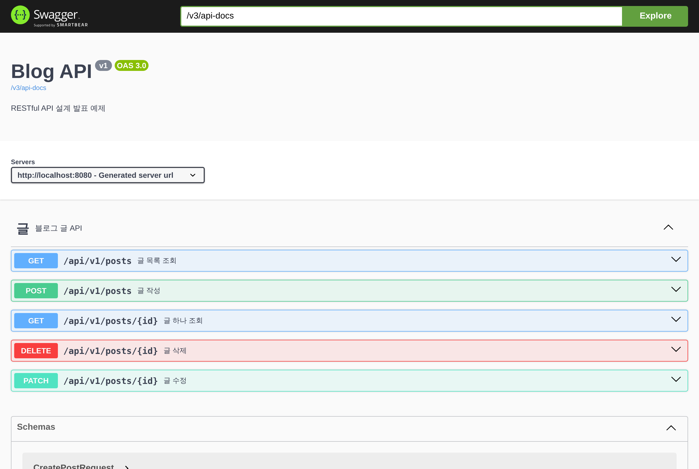

> 질문이 나오면 꺼내는 예비 슬라이드입니다 (Swagger 화면 전체를 보고 싶다고 하면). 실제로 띄운 Swagger UI입니다. 컨트롤러에 적은 API 다섯 개가 메서드 색과 함께 자동으로 나열됩니다. 따로 문서를 쓴 게 아니라 코드만 썼습니다.

파일: [`실제-화면/swagger-1-목록.png`](실제-화면/swagger-1-목록.png) (예제 프로젝트를 실행해 찍은 실제 화면)

## 실제 화면: Swagger에서 실행 (404) (예비 슬라이드)

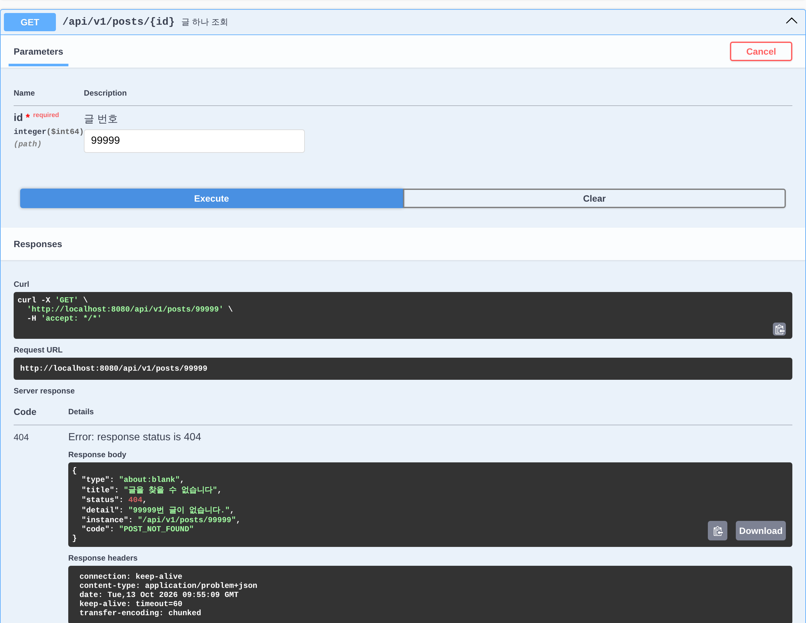

> 질문이 나오면 꺼내는 예비 슬라이드입니다 (에러 응답이 실제로 어떻게 오는지 물으면). 없는 글 99999를 넣으면 404와 함께, 슬라이드 8에서 본 공통 에러 형식 그대로 code: POST_NOT_FOUND가 옵니다.

파일: [`실제-화면/swagger-3-실행-404.png`](실제-화면/swagger-3-실행-404.png) (예제 프로젝트를 실행해 찍은 실제 화면)

## 실제 화면: Spring REST Docs 문서 (예비 슬라이드)

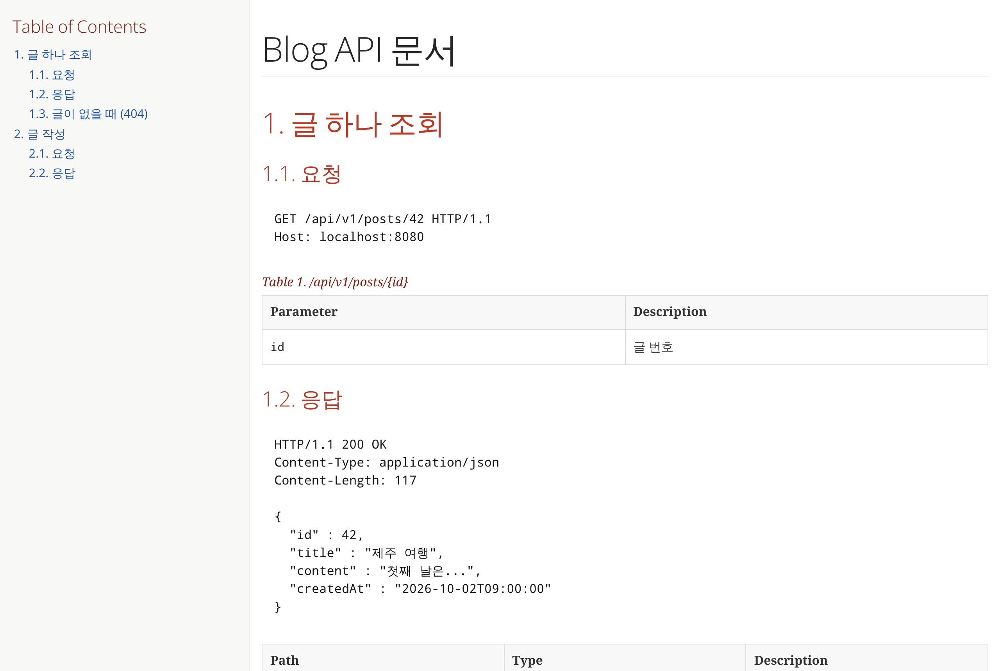

> 질문이 나오면 꺼내는 예비 슬라이드입니다 (REST Docs 문서 전체 모습을 물으면). 같은 API를 Spring REST Docs로 만든 문서입니다. 이 페이지는 테스트를 실행했을 때 실제로 오간 요청과 응답으로 만들어집니다.

파일: [`실제-화면/restdocs-1-첫화면.png`](실제-화면/restdocs-1-첫화면.png) (예제 프로젝트를 실행해 찍은 실제 화면)

## 단일 서버의 요청 흐름 (예비 슬라이드)

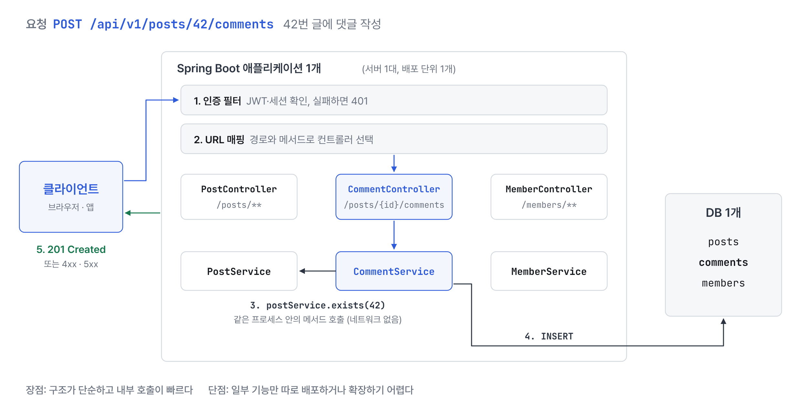

> 질문이 나오면 꺼내는 예비 슬라이드입니다 (실제 서버 안에서 요청이 어떻게 처리되는지 물으면). 단일 서버에서는 애플리케이션 하나가 요청을 모두 처리합니다. 인증 필터가 JWT나 세션을 확인하고, URL 매핑이 경로와 메서드를 보고 CommentController를 고릅니다. CommentService는 42번 글이 있는지 PostService에 메서드 호출로 확인합니다. 같은 프로세스 안이라 네트워크를 타지 않습니다. 데이터는 DB 하나에 저장합니다. 구조가 단순하고 빠르지만, 댓글 기능만 따로 배포하거나 확장하기는 어렵습니다.

파일: [`15-단일-서버의-요청-흐름.png`](15-단일-서버의-요청-흐름.png) · [`15-단일-서버의-요청-흐름.svg`](15-단일-서버의-요청-흐름.svg)

## MSA의 요청 흐름 (예비 슬라이드)

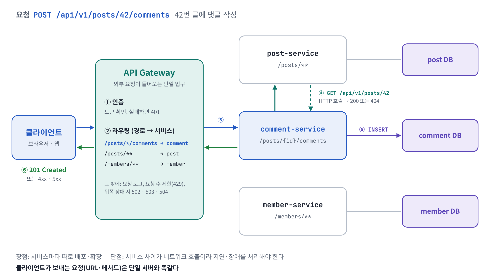

> 질문이 나오면 꺼내는 예비 슬라이드입니다 (MSA에서는 어떻게 되는지 물으면). MSA에서는 기능별로 서비스를 나눠 따로 배포하고, 서비스마다 자기 DB를 가집니다. 외부 요청은 API Gateway 하나로 들어오고, 게이트웨이가 인증을 처리한 뒤 경로를 보고 comment-service로 전달합니다. comment-service는 42번 글이 있는지 post-service에 HTTP로 GET 요청을 보냅니다. 단일 서버에서 메서드 호출이던 부분이 REST API 호출로 바뀌는 겁니다. 그래서 서비스끼리 통신할 때도 오늘 다룬 URL, 메서드, 상태 코드 규칙이 그대로 적용됩니다. 클라이언트가 보내는 요청은 단일 서버와 똑같습니다.

파일: [`16-MSA의-요청-흐름.png`](16-MSA의-요청-흐름.png) · [`16-MSA의-요청-흐름.svg`](16-MSA의-요청-흐름.svg)

## MSA에서 에러가 전달되는 흐름 (예비 슬라이드)

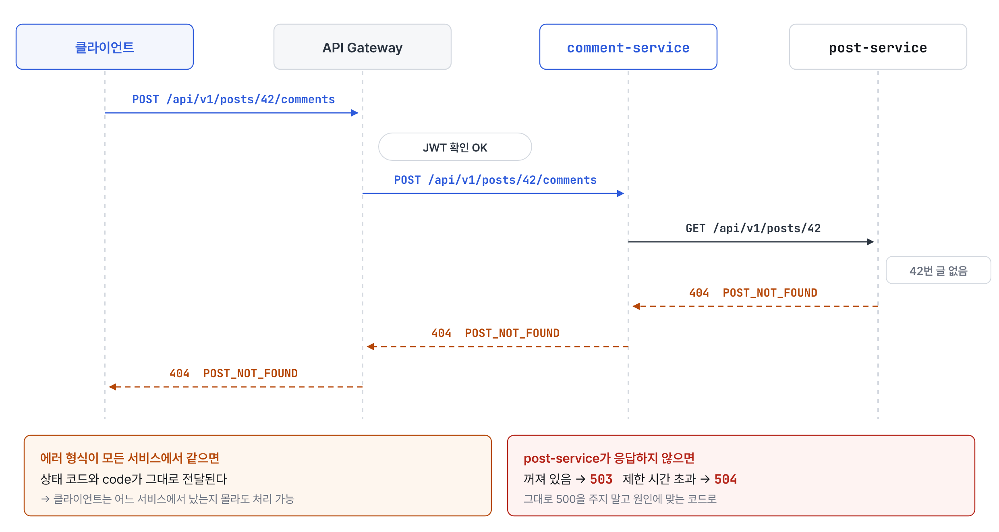

> 질문이 나오면 꺼내는 예비 슬라이드입니다 (MSA에서 에러는 어떻게 전달되는지 물으면). 42번 글이 없으면 post-service가 404와 POST_NOT_FOUND를 돌려줍니다. comment-service와 게이트웨이가 같은 상태 코드와 에러 형식을 쓰면, 이 에러는 그대로 클라이언트까지 전달됩니다. 클라이언트는 어느 서비스에서 에러가 났는지 몰라도 code만 보고 처리할 수 있습니다. post-service가 꺼져 있으면 503, 제한 시간 안에 응답이 없으면 504를 줍니다. 모든 에러를 500으로 뭉뚱그리지 않고 원인에 맞는 코드를 주는 이유가 여기 있습니다.

파일: [`17-MSA에서-에러가-전달되는-흐름.png`](17-MSA에서-에러가-전달되는-흐름.png) · [`17-MSA에서-에러가-전달되는-흐름.svg`](17-MSA에서-에러가-전달되는-흐름.svg)

## 그림 고치기

그림은 `발표/그림/만들기/그림-생성.py` 로 만듭니다. 글자나 위치를 바꾼 뒤 아래처럼 다시 만들면 됩니다.

```bash
python3 발표/그림/만들기/그림-생성.py 발표/그림     # SVG 다시 만들기
node 발표/그림/만들기/png-만들기.js 발표/그림          # PNG 다시 만들기 (Playwright 필요)
node 발표/그림/만들기/png-만들기.js 발표/그림/애니메이션
```

## 애니메이션용 그림

`애니메이션/11-주소-쌓기-1단계` ~ `4단계`는 그림 11의 주소를 한 조각씩 쌓아 가는 그림입니다. 슬라이드 4장에 같은 위치로 넣고 차례로 넘기면 주소가 늘어나는 것처럼 보입니다.
