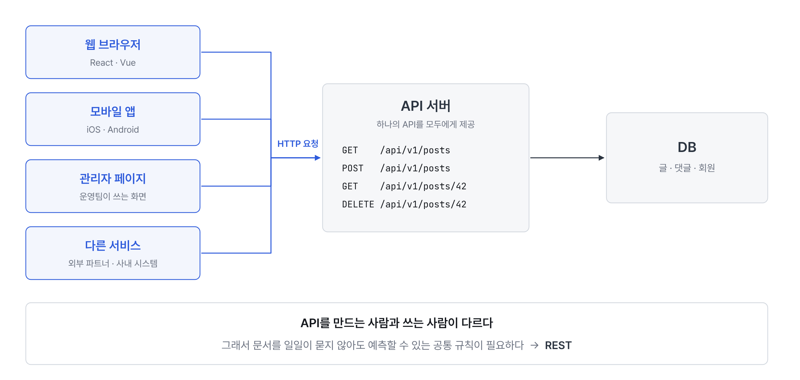

# 발표 그림

슬라이드에 넣는 그림 21장입니다. 모든 예시는 자료 전체와 같은 **블로그 API(42번 글)** 를 씁니다.

- **PNG**: PPT·키노트에 바로 붙여 넣기 (2배 해상도)
- **SVG**: 크기를 키워도 깨지지 않음. 글꼴은 Noto Sans KR · JetBrains Mono 기준이고, 없으면 맑은 고딕 · Consolas 로 대신 보입니다.

슬라이드 번호는 [발표 흐름 (15분)](발표-흐름-15분.md) 의 번호입니다.

## 왜 요청을 보내나 (슬라이드 2 (도입))


> 웹이나 앱 화면에 보이는 글, 댓글, 회원 정보는 사용자 기기에 저장되어 있지 않고 서버의 DB에 있습니다. 그래서 화면은 데이터가 필요할 때마다 서버에 요청을 보냅니다. 블로그 첫 화면을 열면 글 목록을 조회하는 GET 요청이, 저장 버튼을 누르면 글을 생성하는 POST 요청이 나갑니다. 사용자의 동작 하나가 HTTP 요청 하나가 되고, 서버는 그 요청을 처리해 결과를 상태 코드와 함께 돌려줍니다.

파일: [`00-왜-요청을-보내나.png`](00-왜-요청을-보내나.png) · [`00-왜-요청을-보내나.svg`](00-왜-요청을-보내나.svg)

## 여러 클라이언트가 같은 API를 쓴다 (슬라이드 2 (도입))



> 이 API를 호출하는 쪽은 하나가 아닙니다. 웹 브라우저, 모바일 앱, 관리자 페이지, 다른 서비스가 모두 같은 서버의 API를 호출합니다. API를 만드는 사람과 쓰는 사람이 다르기 때문에, 주소와 메서드, 응답 형식이 일관되지 않으면 쓰는 쪽은 API마다 문서를 찾아보거나 물어봐야 합니다. 그래서 누구나 예측할 수 있는 공통 규칙이 필요하고, 그 규칙이 오늘 설명할 REST입니다.

파일: [`00b-여러-클라이언트가-같은-API를-쓴다.png`](00b-여러-클라이언트가-같은-API를-쓴다.png) · [`00b-여러-클라이언트가-같은-API를-쓴다.svg`](00b-여러-클라이언트가-같은-API를-쓴다.svg)

## 클라이언트와 서버 (슬라이드 3)


> 클라이언트는 브라우저나 앱처럼 요청을 보내는 쪽이고, 서버는 그 요청을 처리하는 쪽입니다. 서버는 필요하면 DB에서 데이터를 조회하거나 저장한 뒤 결과를 응답으로 돌려줍니다. 클라이언트는 DB에 직접 접근하지 않고, 서버가 열어 둔 API를 통해서만 데이터를 주고받습니다. 이 API를 어떤 규칙으로 설계할지가 오늘 주제입니다.

파일: [`01-클라이언트와-서버.png`](01-클라이언트와-서버.png) · [`01-클라이언트와-서버.svg`](01-클라이언트와-서버.svg)

## 요청과 응답의 구조 (슬라이드 3)


> HTTP 요청은 메서드와 주소, 헤더, 바디로 구성됩니다. 메서드와 주소는 어떤 자원에 무엇을 할지, 헤더는 데이터 형식이나 인증 토큰 같은 부가 정보, 바디는 실제로 보내는 데이터입니다. 응답도 같은 구조로 상태 코드, 헤더, 바디가 돌아옵니다. 글을 생성하면 201과 함께 Location 헤더로 새 글의 주소를 알려 줍니다.

파일: [`02-요청과-응답의-구조.png`](02-요청과-응답의-구조.png) · [`02-요청과-응답의-구조.svg`](02-요청과-응답의-구조.svg)

## REST 세 줄 약속 (슬라이드 4)


> REST는 요청 한 줄을 세 부분으로 나눠 표현하는 규칙입니다. 대상 자원은 URL로, 수행할 행동은 HTTP 메서드로, 처리 결과는 상태 코드로 표현합니다. 그래서 이 한 줄은 별도 설명 없이 '42번 글을 삭제했고, 성공했다'로 읽힙니다.

파일: [`03-REST-세-줄-약속.png`](03-REST-세-줄-약속.png) · [`03-REST-세-줄-약속.svg`](03-REST-세-줄-약속.svg)

## 동사 URL과 자원 URL (슬라이드 5)


> URL에 get, create, update, delete 같은 동사를 넣으면, 같은 글 하나를 다루는데도 기능마다 URL이 하나씩 늘어나고, 이름 짓는 방식도 사람마다 달라집니다. REST에서는 행동은 HTTP 메서드로 표현하고 URL은 명사로 자원만 가리킵니다. 그래서 /posts/42라는 주소 하나에 GET, PATCH, DELETE만 바꿔 보내서 조회, 수정, 삭제를 합니다. 특히 삭제를 GET으로 만들면 안 됩니다. GET은 표준에서 데이터를 바꾸지 않는 요청으로 정의되어 있어서, 검색 엔진 크롤러나 메신저의 링크 미리보기는 사용자가 누르지 않아도 URL에 GET을 보냅니다. 삭제 URL을 메신저로 보내기만 해도 글이 지워질 수 있는 겁니다. 그래서 데이터를 바꾸는 요청은 반드시 POST, PATCH, DELETE 같은 메서드로 만듭니다.

파일: [`04a-동사-URL과-자원-URL.png`](04a-동사-URL과-자원-URL.png) · [`04a-동사-URL과-자원-URL.svg`](04a-동사-URL과-자원-URL.svg)

## 자원 중심 URL (슬라이드 5)


> 명사 URL은 계층으로 짭니다. 컬렉션은 복수형 /posts, 그중 하나는 /posts/42, 하위 자원은 /posts/42/comments입니다. 중첩은 2단계까지만 둡니다. /members/3/posts/42/comments/7처럼 깊어지면 댓글 하나를 보려고 회원 id와 글 id를 모두 알아야 하고, 서버는 단계마다 관계가 맞는지 확인해야 합니다. 댓글 7번은 id만으로 이미 하나로 정해지므로, 깊어지면 /comments/7처럼 끊습니다. 특정 자원을 가리키는 값은 경로에, 정렬이나 개수처럼 보여 주는 방식을 바꾸는 값은 물음표 뒤 쿼리에 둡니다. URL은 소문자로 쓰고 단어 사이는 하이픈으로 잇습니다. 앞에 붙은 /api/v1은 버전입니다. 응답 구조를 크게 바꾸면, 이미 사용자 폰에 설치된 예전 앱은 바뀐 응답을 읽지 못해 오류가 납니다. 앱은 사용자가 업데이트하기 전까지 예전 버전으로 남아 있기 때문입니다. 그래서 구조를 크게 바꿀 때는 /api/v2를 새로 열고 v1은 그대로 둡니다. 예전 앱은 v1을, 새 앱은 v2를 쓰다가, 대부분 업데이트하면 v1을 종료합니다.

파일: [`04b-자원-중심-URL.png`](04b-자원-중심-URL.png) · [`04b-자원-중심-URL.svg`](04b-자원-중심-URL.svg)

## 메서드별로 달라지는 결과 (슬라이드 6)


> 같은 42번 글에 메서드만 바꿔 보냈을 때 서버 상태가 어떻게 바뀌는지 보여 줍니다. GET은 조회만 하고, POST는 새 자원을 만들고, DELETE는 삭제합니다. PUT과 PATCH는 둘 다 수정이지만 차이가 있습니다. PUT은 자원 전체를 보낸 값으로 교체하므로 보내지 않은 본문이 비워질 수 있고, PATCH는 보낸 필드만 변경합니다. 그래서 일부 수정에는 PATCH를 씁니다.

파일: [`05-메서드별-결과.png`](05-메서드별-결과.png) · [`05-메서드별-결과.svg`](05-메서드별-결과.svg)

## 멱등성 (슬라이드 6)


> 멱등성은 같은 요청을 여러 번 보내도 서버 상태가 한 번 보낸 것과 같은 성질입니다. POST를 세 번 보내면 글이 세 개 생기므로 멱등하지 않습니다. DELETE는 두 번째부터 404가 오지만 '42번 글이 없다'는 서버 상태는 같으므로 멱등합니다. 네트워크 오류로 재시도할 때 멱등한 요청은 안전하게 다시 보낼 수 있고, POST는 중복 생성을 막는 처리가 필요합니다.

파일: [`06-멱등성.png`](06-멱등성.png) · [`06-멱등성.svg`](06-멱등성.svg)

## 상태 코드 네 갈래 (슬라이드 7)


> 상태 코드는 첫 자리로 결과의 종류를 나눕니다. 2xx는 성공, 3xx는 리다이렉트, 4xx는 클라이언트 오류, 5xx는 서버 오류입니다. 3xx는 REST API에서는 드물게 쓰고, 주로 다루는 건 2xx, 4xx, 5xx입니다. 하지 말아야 할 것이 하나 있습니다. 실패했는데 200 OK에 success: false를 담아 보내는 방식입니다. 모니터링, 프론트엔드의 에러 처리, 자동 재시도, 캐시는 응답 바디를 읽지 않고 상태 코드만 봅니다. 그래서 실패를 200으로 주면 장애가 나도 알림이 오지 않고, 화면에는 저장 완료가 뜨고, 실패 응답이 캐시될 수 있습니다. 이렇게 하는 곳이 있는 이유는, 통신 자체는 성공했으니 200이라고 보거나, 상태 코드보다 세밀한 에러 구분이 필요해서입니다. 세밀한 구분은 상태 코드를 버리지 않고 바디의 에러 코드로 하면 됩니다. 상태 코드로 큰 분류를, 바디의 code로 세부 원인을 줍니다.

파일: [`07-상태-코드-네-갈래.png`](07-상태-코드-네-갈래.png) · [`07-상태-코드-네-갈래.svg`](07-상태-코드-네-갈래.svg)

## 자주 만나는 에러 상태 코드 (슬라이드 7)


> 실무에서 에러가 나면 대부분 이 아홉 가지 중 하나입니다. 4xx는 요청을 고쳐야 하는 경우입니다. 400은 필수 값이 빠졌거나 형식이 틀린 경우, 401은 JWT나 세션 같은 인증 정보가 없거나 만료된 경우, 403은 권한이 없는 경우, 404는 자원이 없거나 URL이 틀린 경우, 409는 중복이나 동시 수정 충돌입니다. 5xx는 서버 쪽 문제입니다. 500은 처리하지 못한 예외라 서버 로그의 스택 트레이스를 봐야 합니다. 502, 503, 504는 게이트웨이나 프록시 뒤의 서버가 잘못된 응답을 줬거나, 처리할 수 없는 상태거나, 제한 시간 안에 응답하지 않은 경우입니다. 그중 가장 자주 보는 건 400, 401, 404, 500입니다.

파일: [`07b-자주-만나는-에러-코드.png`](07b-자주-만나는-에러-코드.png) · [`07b-자주-만나는-에러-코드.svg`](07b-자주-만나는-에러-코드.svg)

## 401과 403 (슬라이드 7)


> 401과 403은 실패한 단계가 다릅니다. 401은 인증 실패로, JWT나 세션 같은 인증 정보가 없거나 만료되어 서버가 요청한 사람이 누구인지 확인하지 못한 경우입니다. 403은 인가 실패로, 누구인지는 확인했지만 이 작업을 할 권한이 없는 경우입니다. 예를 들어 다른 사람의 글을 삭제하려 하면 403입니다.

파일: [`08-401과-403.png`](08-401과-403.png) · [`08-401과-403.svg`](08-401과-403.svg)

## 공통 에러 형식 (슬라이드 8)


> 왼쪽은 API마다 에러를 다르게 보내는 경우입니다. 글 API는 error 필드에, 댓글 API는 msg 필드에 담고, 회원 API는 실패인데 200과 문자열 "FAIL"을 보냅니다. 그러면 프론트엔드는 API마다 에러를 꺼내는 코드를 따로 짜야 하고, 새 API가 생길 때마다 에러를 어떻게 주는지 물어봐야 합니다. 토큰 만료 같은 공통 처리도 한 곳에 모을 수 없습니다. 원인도 구분하기 어려워 문장으로 분기하게 되는데, 백엔드가 문구를 고치는 순간 그 분기는 동작하지 않습니다. 오른쪽처럼 모든 API가 같은 모양으로 에러를 보내게 맞추면 이 문제가 사라집니다. 형식은 RFC 9457 표준의 type(에러 종류), title(짧은 제목), status(상태 코드), detail(이번 요청에 대한 설명)을 쓰고, 우리 팀이 정한 에러 코드 code를 추가합니다. 프론트엔드는 에러 처리를 한 곳에만 쓰고, code로 분기하고, detail 문장은 화면에 보여 주기만 합니다. 그래서 문구를 바꾸거나 번역해도 분기가 깨지지 않습니다. 스택 트레이스나 SQL 같은 내부 정보는 공격의 힌트가 되므로 응답에 넣지 않고 서버 로그에만 남깁니다.

파일: [`09-공통-에러-형식.png`](09-공통-에러-형식.png) · [`09-공통-에러-형식.svg`](09-공통-에러-형식.svg)

## 전역 예외 처리와 입력 검증 (슬라이드 9)


> 이 그림은 요청 하나가 서버 안에서 지나가는 길입니다. 요청은 위쪽 줄을 따라 입력 검증, 컨트롤러, 서비스, DB 순서로 처리됩니다. 입력 검증이 맨 앞에 있는 이유는, 제목이 비었다처럼 값만 보고 판단할 수 있는 문제는 DB까지 갈 필요 없이 가장 먼저 돌려보내는 게 가장 싸기 때문입니다. 여기서 실패하면 400입니다. 컨트롤러는 요청을 서비스에 넘기고 결과를 HTTP 응답으로 바꾸는 일만 하며, 성공하면 초록 화살표처럼 200이나 201을 돌려줍니다. 서비스는 글이 있는지, 제목이 중복인지처럼 DB를 조회해야 알 수 있는 업무 규칙을 검사하고, 실패하면 예외를 던집니다. 예외를 던지면 그 자리에서 처리가 멈추고 @Transactional이 DB 작업을 되돌립니다. 예외는 호출한 쪽으로 거꾸로 올라가는데, 중간에 아무도 잡지 않으니 결국 아래의 전역 예외 처리기 한 곳에 도착합니다. 여기서 상태 코드와 공통 에러 형식으로 바꿔 응답하고, 예상 못 한 예외는 로그에 남기고 500으로 답합니다. 처리를 한 곳에 모으니 에러 형식이 항상 같고, 컨트롤러에는 try-catch가 필요 없습니다. 화면에서 이미 검사했더라도 API는 curl이나 Postman으로 직접 호출할 수 있으므로, 서버 검증은 데이터를 지키는 마지막 방어선으로 생략하지 않습니다.

파일: [`10-전역-예외-처리와-입력-검증.png`](10-전역-예외-처리와-입력-검증.png) · [`10-전역-예외-처리와-입력-검증.svg`](10-전역-예외-처리와-입력-검증.svg)

## 검색·정렬·페이징 주소 읽기 (슬라이드 10)


> 목록 조회의 조건은 모두 쿼리 스트링으로 전달합니다. 검색 조건은 topic, keyword, 정렬은 sort=필드,방향, 페이징은 page와 size로 표현합니다. 값을 보내지 않으면 서버가 정한 기본값, 예를 들어 최신순 20개를 적용합니다.

파일: [`11-검색-정렬-페이징-주소.png`](11-검색-정렬-페이징-주소.png) · [`11-검색-정렬-페이징-주소.svg`](11-검색-정렬-페이징-주소.svg)

## 오프셋과 커서 (슬라이드 10)


> 페이징 방식은 두 가지입니다. 오프셋은 page와 size로 앞의 데이터를 건너뛰고 가져오는 방식으로, 페이지 번호로 바로 이동할 수 있어 게시판에 맞습니다. 대신 뒤 페이지일수록 건너뛸 행이 많아져 느려지고, 그사이 새 글이 추가되면 결과가 겹치거나 빠질 수 있습니다. 커서는 마지막으로 받은 항목의 기준값 다음부터 가져오는 방식이라 데이터가 많아도 성능이 일정하고 무한 스크롤에 맞습니다. 어느 방식이든 size 최댓값, 기본 정렬, 정렬 가능한 필드는 서버에서 제한합니다.

파일: [`12-오프셋과-커서.png`](12-오프셋과-커서.png) · [`12-오프셋과-커서.svg`](12-오프셋과-커서.svg)

## API 문서가 만들어지는 길 (슬라이드 11)


> API 문서는 OpenAPI 명세로 작성합니다. springdoc을 쓰면 컨트롤러와 DTO의 어노테이션을 읽어 명세가 자동으로 만들어지고, Swagger UI가 그 명세를 화면으로 보여 주며 직접 호출도 할 수 있습니다. 문서와 실제 동작이 어긋나지 않는 게 중요하다면, 테스트가 통과해야 문서가 생성되는 Spring REST Docs를 씁니다. 문서에는 메서드와 URL, 인증 방식, 요청·응답 예시, 에러 코드 표가 들어가야 합니다.

파일: [`13-API-문서가-만들어지는-길.png`](13-API-문서가-만들어지는-길.png) · [`13-API-문서가-만들어지는-길.svg`](13-API-문서가-만들어지는-길.svg)

## 단일 서버의 요청 흐름 (슬라이드 12 앞 (추가))


> 단일 서버에서는 애플리케이션 하나가 요청을 모두 처리합니다. 인증 필터가 JWT나 세션을 확인하고, URL 매핑이 경로와 메서드를 보고 CommentController를 고릅니다. CommentService는 42번 글이 있는지 PostService에 메서드 호출로 확인합니다. 같은 프로세스 안이라 네트워크를 타지 않습니다. 데이터는 DB 하나에 저장합니다. 구조가 단순하고 빠르지만, 댓글 기능만 따로 배포하거나 확장하기는 어렵습니다.

파일: [`15-단일-서버의-요청-흐름.png`](15-단일-서버의-요청-흐름.png) · [`15-단일-서버의-요청-흐름.svg`](15-단일-서버의-요청-흐름.svg)

## MSA의 요청 흐름 (슬라이드 12 앞 (추가))


> MSA에서는 기능별로 서비스를 나눠 따로 배포하고, 서비스마다 자기 DB를 가집니다. 외부 요청은 API Gateway 하나로 들어오고, 게이트웨이가 인증을 처리한 뒤 경로를 보고 comment-service로 전달합니다. comment-service는 42번 글이 있는지 post-service에 HTTP로 GET 요청을 보냅니다. 단일 서버에서 메서드 호출이던 부분이 REST API 호출로 바뀌는 겁니다. 그래서 서비스끼리 통신할 때도 오늘 다룬 URL, 메서드, 상태 코드 규칙이 그대로 적용됩니다. 클라이언트가 보내는 요청은 단일 서버와 똑같습니다.

파일: [`16-MSA의-요청-흐름.png`](16-MSA의-요청-흐름.png) · [`16-MSA의-요청-흐름.svg`](16-MSA의-요청-흐름.svg)

## MSA에서 에러가 전달되는 흐름 (슬라이드 12 앞 (추가))


> 42번 글이 없으면 post-service가 404와 POST_NOT_FOUND를 돌려줍니다. comment-service와 게이트웨이가 같은 상태 코드와 에러 형식을 쓰면, 이 에러는 그대로 클라이언트까지 전달됩니다. 클라이언트는 어느 서비스에서 에러가 났는지 몰라도 code만 보고 처리할 수 있습니다. post-service가 꺼져 있으면 503, 제한 시간 안에 응답이 없으면 504를 줍니다. 모든 에러를 500으로 뭉뚱그리지 않고 원인에 맞는 코드를 주는 이유가 여기 있습니다.

파일: [`17-MSA에서-에러가-전달되는-흐름.png`](17-MSA에서-에러가-전달되는-흐름.png) · [`17-MSA에서-에러가-전달되는-흐름.svg`](17-MSA에서-에러가-전달되는-흐름.svg)

## 한 장 요약: 요청 하나의 여정 (슬라이드 12)


> 오늘 내용을 요청 하나의 처리 순서로 정리하면 이렇습니다. 자원은 URL로, 행동은 메서드로 표현하고, 입력은 서버에서 검증하고, 예외는 한곳에서 처리하고, 결과는 상태 코드와 공통 응답 형식으로 돌려줍니다. 목록은 쿼리로 나눠서 주고, 이 모든 규칙은 API 문서로 공개합니다.

파일: [`14-한-장-요약.png`](14-한-장-요약.png) · [`14-한-장-요약.svg`](14-한-장-요약.svg)

## 그림 고치기

그림은 `발표/그림/만들기/그림-생성.py` 로 만듭니다. 글자나 위치를 바꾼 뒤 아래처럼 다시 만들면 됩니다.

```bash
python3 발표/그림/만들기/그림-생성.py 발표/그림     # SVG 다시 만들기
node 발표/그림/만들기/png-만들기.js 발표/그림          # PNG 다시 만들기 (Playwright 필요)
```
